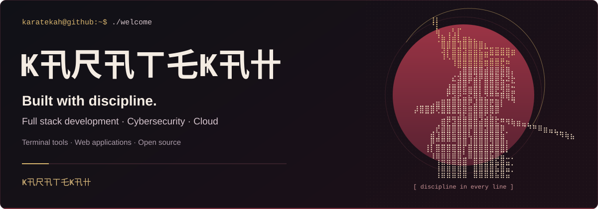

<p align="center">
  
</p>

<p align="center">Building terminal tools, web applications and security-minded software.</p>

<h2 align="center">🌱 My skills</h2>

<h4 align="center">💻 Programming languages</h4>

<p align="center">


</p>

<h4 align="center">📚 Frameworks and libraries</h4>

<p align="center">


</p>

<h4 align="center">⚙️ Software and tools</h4>

<p align="center">


</p>

<h4 align="center">☁️ Databases and cloud</h4>

<p align="center">


</p>

<h2 align="center">✨ Selected projects</h2>

- 💬 [**Karatty**](https://github.com/karatekah/karatty) — Experimental terminal chat with SSH-key identities, accepted 1:1 conversations, local E2EE and encrypted archives. **Go · Rust · PostgreSQL.**

  [Download alpha](https://github.com/karatekah/karatty/releases/tag/v0.1.0-alpha.1) · [Quick start](https://github.com/karatekah/karatty/blob/main/docs/quickstart.md) · Docs: [EN](https://github.com/karatekah/karatty#readme) / [ES](https://github.com/karatekah/karatty/blob/main/docs/es/README.md) / [IT](https://github.com/karatekah/karatty/blob/main/docs/it/README.md)

  [](https://github.com/karatekah/karatty/stargazers) [](https://github.com/karatekah/karatty/watchers) [](https://github.com/karatekah/karatty/commits)

- 🥋 [**Octajang**](https://github.com/karatekah/octajang) — Manual Taekwondo scoreboard alpha for training and exhibitions, with a second-screen display, match records and JSON backups. **TypeScript · Vite.**

  [Try the demo](https://octajang.vercel.app) · [User guide](https://octajang.vercel.app/guide.html) · [Alpha release](https://github.com/karatekah/octajang/releases/tag/v0.1.0-alpha.1) · Docs: [EN](https://github.com/karatekah/octajang#readme) / [ES](https://github.com/karatekah/octajang/blob/main/docs/es/README.md) / [IT](https://github.com/karatekah/octajang/blob/main/docs/it/README.md)

  [](https://github.com/karatekah/octajang/stargazers) [](https://github.com/karatekah/octajang/watchers) [](https://github.com/karatekah/octajang/commits)

- 🔐 [**passGeneratorV1.0**](https://github.com/karatekah/passGeneratorV1.0) — Configurable CLI password generator using Python's `secrets` module. **Python.**

  [](https://github.com/karatekah/passGeneratorV1.0/stargazers) [](https://github.com/karatekah/passGeneratorV1.0/watchers) [](https://github.com/karatekah/passGeneratorV1.0/commits)

- 🗝️ [**passGenerator-Manage**](https://github.com/karatekah/passGenerator-Manage) — A second Python password-generator repository. **Python.**

  [](https://github.com/karatekah/passGenerator-Manage/stargazers) [](https://github.com/karatekah/passGenerator-Manage/watchers) [](https://github.com/karatekah/passGenerator-Manage/commits)

- 🛠️ [**Karatekah — GitHub profile**](https://github.com/karatekah/karatekah) — Samurai-themed profile README with technology badges and daily public GitHub activity cards. **Markdown · SVG · GitHub Actions.**

  [](https://github.com/karatekah/karatekah/stargazers) [](https://github.com/karatekah/karatekah/watchers) [](https://github.com/karatekah/karatekah/commits)

<h2 align="center">📊 GitHub activity</h2>

<p align="center">
  
  
</p>

<p align="center"><a href="https://github.com/karatekah/karatekah/actions/workflows/profile-stats.yml"></a></p>

<sub>Public data only. Cards are generated by GitHub Readme Stats Action and refreshed daily through GitHub Actions. Language shares measure code size, not proficiency. Watcher badges count repository subscribers.</sub>

---

<p align="center"><strong>Ҝ卂尺卂ㄒ乇Ҝ卂卄</strong></p>

<details>
<summary>Copy the character art</summary>

```text
⠀⠀⠀⢰⡆
⠀⠀⠀⠘⡇
⠀⠀⠀⠀⢷⠀⢠⢣⡏
⠀⠀⠀⠀⢘⣷⢸⣾⣇⣶⣦⣄
⠀⠀⠀⠀⠀⣿⣿⣿⣹⣿⣿⣷⣿⣆⣀⣀
⠀⠀⠀⠀⠀⢼⡇⣿⣿⣽⣶⣶⣯⣭⣷⣶⣿⣿⣶
⠀⠀⠀⠀⠀⠸⠣⢿⣿⣿⣿⣿⡿⣛⣭⣭⣭⡙⠁
⠀⠀⠀⠀⠀⠀⠀⠸⣿⣿⣿⣿⣿⠿⠿⠿⢯⡛
⠀⠀⠀⠀⠀⠀⠀⠀⢠⣿⣿⣿⣿⣾⣿⡿⡷⢿⡄
⠀⠀⠀⠀⠀⠀⠀⡔⣺⣿⣿⣽⡿⣿⣿⣿⣟⡳⠦
⠀⠀⠀⠀⠀⠀⢠⣭⣾⣿⠃⣿⡇⣿⣿⡷⢾⣭⡓
⠀⠀⠀⠀⠀⠀⣾⣿⡿⠷⣿⣿⡇⣿⣿⣟⣻⠶⣭
⠀⠀⠀⠀⠀⠀⣋⣵⣞⣭⣮⢿⣧⣝⣛⡛⠿⢿⣦
⠀⣀⣀⣠⣶⣿⣿⣿⣿⡿⠟⣼⣿⡿⣟⣿⡇⠀⠙
⡼⣿⣿⣿⢟⣿⣿⣿⣷⡿⠿⣿⣿⣿⣿⣿
⠀⠀⠉⠁⠀⢉⣭⣭⣽⣯⣿⣿⢿⣫⣮⣅⣀
⠀⠀⠀⠀⢀⣿⣟⣽⣿⣿⣿⣿⣾⣿⣿⣯⡛⠻⢷⣶⣤⣄⡀
⠀⠀⠀⢀⡞⣾⣿⣿⣿⣿⡟⣿⣿⣽⣿⣿⡿⠀⠀⠀⠈⠙⠛⠿⣶⣤⣄⡀
⠀⠀⠀⣾⣸⣿⣿⣷⣿⣿⢧⣿⣿⣿⣿⣿⣷⠁⠀⠀⠀⠀⠀⠀⠀⠈⠙⠻⢷⣦
⠀⠀⠀⡿⣛⣛⣛⣛⣿⣿⣸⣿⣿⣿⣻⣿⣿⠆
⠀⠀⢸⡇⣿⣿⣿⣿⣿⡏⣿⣿⣿⣿⣿⣿⣿⡇
⠀⠀⠀⢰⣶⣶⣶⣾⣿⢃⣿⣿⣿⣿⣯⣿⣭⠁
    ⢰⣶⣶⣶⣾⣿ ⣿⣿⣿⣿⣯⣿⣭⠁
    ⢰⣶⣶⣶⣾⣿ ⣿⣿⣿⣿⣯⣿⣭⠁
    ⢰⣶⣶⣶⣾⣿ ⣿⣿⣿⣿⣯⣿⣭⠁
```

</details>
